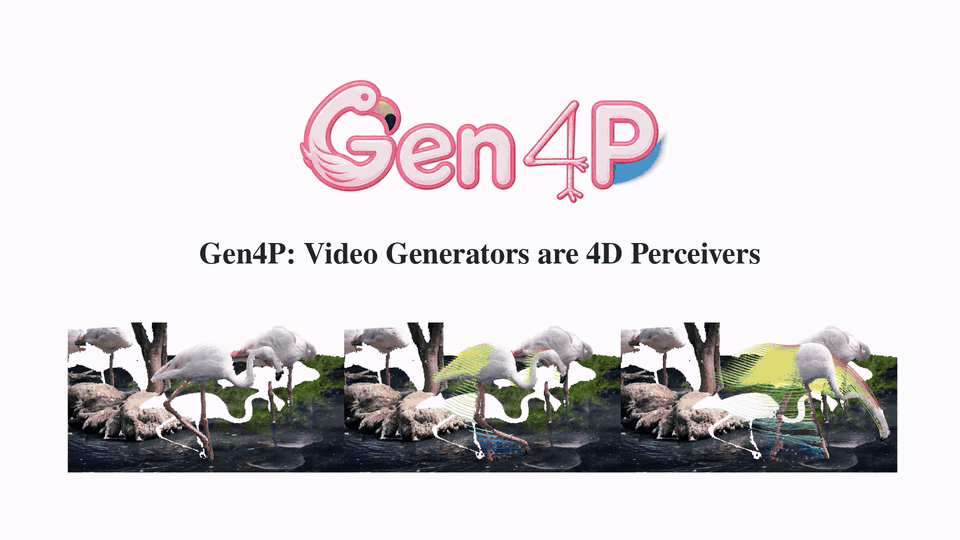

<div align="center">

# Gen4P: Video Generators are 4D Perceivers

[Yitong Xia](https://www.linkedin.com/in/yitong-xia-5a111120a/?isSelfProfile=true)<sup>1</sup>,
[Zeren Jiang](https://jzr99.github.io/)<sup>2</sup>,
[Chuanxia Zheng](https://physicalvision.github.io/people/~chuanxia)<sup>1</sup>

<sup>1</sup>Physical Vision Group (PVG), Nanyang Technological University (NTU)<br>
<sup>2</sup>Visual Geometry Group (VGG), Oxford University

<a href="assets/Gen4P_teaser_v3.mp4">
  
</a>

<em>Faithful structure preservation and motion tracking on challenging scenes like flamingo.</em>

</div>

> **TL;DR:** Gen4P repurposes a video generator for feed-forward 4D perception, with single-pass encoding, on-demand decoding for spatial flexibility, continuous-time embeddings for temporal flexibility, and a frozen depth LoRA as a plug-in geometry prior.

<div align="center">

[](https://arxiv.org/abs/2610.22371)
[](https://gen4p.github.io/)
[](https://huggingface.co/papers/2610.22371)

</div>

## 🛠️ Installation

WIP.

## 🚀 Usage

WIP.

## 🙏 Acknowledgment

This research is supported by the NTU SUG-NAP and National Research Foundation, Singapore, under its NRF Fellowship Award NRF-NRFF17-2025-0009. We would like to acknowledge the High Performance Computing Centre of NTU Singapore for providing the computing resources, facilities, and services that have contributed significantly to this work. Zeren Jiang is supported by the Clarendon Scholarship.

## 📖 BibTeX

```bibtex
@misc{xia2026gen4p,
    title={Gen4P: Video Generators are 4D Perceivers},
    author={Yitong Xia and Zeren Jiang and Chuanxia Zheng},
    year={2026},
    eprint={2610.22371},
    archivePrefix={arXiv},
    primaryClass={cs.CV},
    url={https://arxiv.org/abs/2610.22371}
}
```

