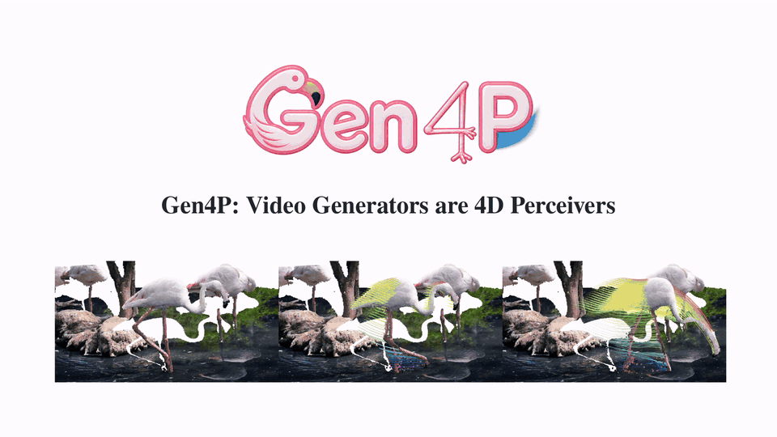
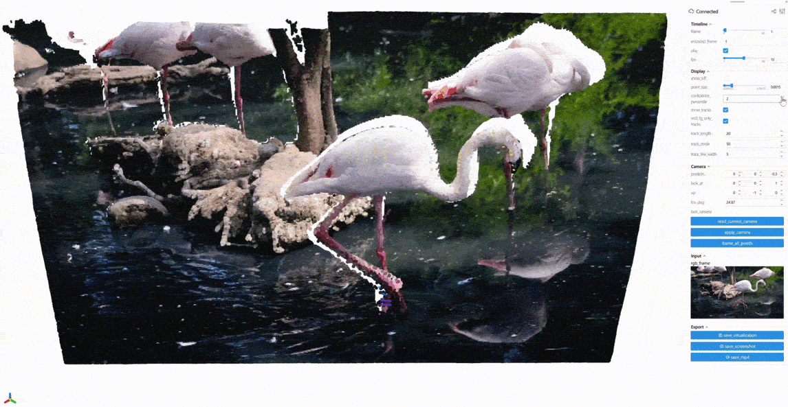
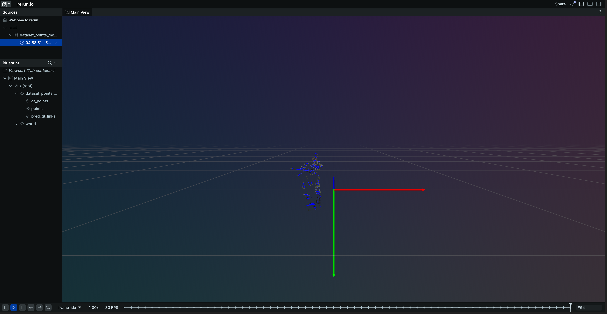
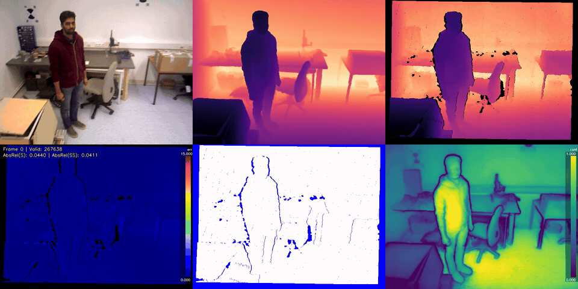

<div align="center">

# Gen4P: Video Generators are 4D Perceivers

[Yitong Xia](https://www.linkedin.com/in/yitong-xia-5a111120a/?isSelfProfile=true)<sup>1</sup>,
[Zeren Jiang](https://jzr99.github.io/)<sup>2</sup>,
[Chuanxia Zheng](https://physicalvision.github.io/people/~chuanxia)<sup>1</sup>

<sup>1</sup>Physical Vision Group (PVG), Nanyang Technological University (NTU)<br>
<sup>2</sup>Visual Geometry Group (VGG), Oxford University

<a href="assets/Gen4P_teaser_v3.mp4">
  
</a>

<em>Faithful structure preservation and motion tracking on challenging scenes like flamingo.</em>

</div>

> **TL;DR:** Gen4P repurposes a video generator for feed-forward 4D perception, with single-pass encoding, on-demand decoding for spatial flexibility, continuous-time embeddings for temporal flexibility, and a frozen depth LoRA as a plug-in geometry prior.

<div align="center">

[](https://arxiv.org/abs/2610.22371)
<a href="https://gen4p.github.io/"></a>
[](https://huggingface.co/papers/2610.22371)

</div>

## 🛠️ Installation

### Environment
We use Python 3.10.14 and a CUDA 12.6 driver.

```bash
conda create -n gen4p python=3.10.14 -y
conda activate gen4p
python -m pip install -r requirements.txt
```

### Checkpoints

Download the [Gen4P checkpoint](https://huggingface.co/yitongx/Gen4P) and [DVD prior checkpoint](https://huggingface.co/FayeHongfeiZhang/DVD) to `ckpt/`:

```bash
mkdir ckpt

# Gen4P
hf download yitongx/Gen4P gen4p.pth --local-dir ckpt

# DVD Prior
hf download FayeHongfeiZhang/DVD dvd_1.1.safetensors --local-dir ckpt
```
and place under `ckpt/`:
```text
ckpt/
├── gen4p.pth
└── dvd_1.1.safetensors
```

On the first use, Diffusers also downloads the [Wan2.1-T2V-1.3B base model](https://huggingface.co/Wan-AI/Wan2.1-T2V-1.3B-Diffusers) to the Hugging Face cache.

## 🚀 Usage
**[Input Frames]** We distinguish the resolutions for two types of input frames:
- `img_h`/`img_w`: for **encoder frames**, which are input to the encoder to extract scene tokens.
- `proc_h`/`proc_w`: for **query frames**, which provide local RGB patches for decoder
queries. 
The running codes constrain their aspect ratio differences with 3%, i.e.,  `abs((img_w / img_h) / (proc_w / proc_h) - 1) <= 0.03`. 

Larger aspect ratio differnces may still work but at the cost of performance degradation.

**[Multi-GPU Inference]** The code supports multi-GPU parallel inference by using job placeholders to avoid duplicate inferences. Enable multi-GPU inferences by setting `CUDA_VISIBLE_DEVICES=0,1,...`.

### 🎯 1. Visualization

Visualize dense world tracks in [`Viser`](https://github.com/viser-project/viser). We provide four [DAVIS](https://data.vision.ee.ethz.ch/csergi/share/davis/DAVIS-2017-trainval-Full-Resolution.zip) videos (_bmx-bumps_, _flamingo_, _kite-surf_, and _tennis_) in `inputs/DAVIS/` and you can replace with your own videos.

Run:

```bash
CUDA_VISIBLE_DEVICES=0,1,2,3 \
bash scripts/infer-dense_viser.sh
```
- #Videos ≤ #GPUs: one live Viser server per video, with ports starting at 8081.
- #Videos > #GPUs: offline batch export of `.viser` recordings.

Output folder is `outputs/dense_viser/`.

<p align="center">
  
</p>


### 🎯 2. 3D Tracking

Download [WorldTrack](https://github.com/HavenFeng/St4RTrack#evaluation-benchmarks) following St4RTrack.

Then run:

```bash
DATA_ROOT=/path/to/WorldTrack \
CUDA_VISIBLE_DEVICES=0,1,2,3 \
bash scripts/infer-bench_pttrack.sh
```

Output folder is `outputs/worldtrack/`, contains tracking predictions, APD/EPE metrics, and Rerun visualizations.

Use `Rerun` to view a recording in your browser:

```bash
rerun --serve-web --port auto --web-viewer-port 0 \
  outputs/worldtrack/TRACK/SCENE/dataset_points-mode_srcw.rrd
```
Replace with the actual `.rrd` file path. Open the viewer URL starting like `http://127.0.0.1:xxxxx?url=rerun%...`.

<p align="center">
  
</p>

### 🎯 3. Video Depth

Download and prepare [Bonn](https://github.com/Junyi42/monst3r/blob/main/data/evaluation_script.md#bonn), [Sintel](https://github.com/Junyi42/monst3r/blob/main/data/evaluation_script.md#sintel), and [KITTI](https://github.com/Junyi42/monst3r/blob/main/data/evaluation_script.md#kitti) following MonST3R. 

Then run:

```bash
BONN_ROOT=/path/to/Bonn/rgbd_bonn_dataset \
SINTEL_ROOT=/path/to/Sintel/training/final \
KITTI_ROOT=/path/to/kitti \
CUDA_VISIBLE_DEVICES=0,1,2,3 \
bash scripts/infer-bench_depth.sh
```

Output folder is `outputs/videodepth/`, contains depth predictions, confidences and errors maps (under `eval_vis-0_15/` for each scene).

<p align="center">
  
</p>


### 🎯 4. Camera Pose

Download and prepare [TUM-dynamics](https://github.com/Junyi42/monst3r/blob/main/data/evaluation_script.md#tum-dynamics), [Sintel](https://github.com/Junyi42/monst3r/blob/main/data/evaluation_script.md#sintel), and [ScanNet](https://github.com/Junyi42/monst3r/blob/main/data/evaluation_script.md#scannet) following MonST3R. For TUM, the download script is [`download_tum_dynamics.sh`](https://github.com/Junyi42/monst3r/blob/main/data/download_tum_dynamics.sh).

Then run:
```bash
TUM_ROOT=/path/to/tum \
SINTEL_ROOT=/path/to/sintel \
SCANNET_ROOT=/path/to/scannetv2 \
CUDA_VISIBLE_DEVICES=0,1,2,3 \
bash scripts/infer-bench_campose.sh
```

Output folder is `outputs/campose/`, contains camera poses and ATE/RPE metrics.

## 🙏 Acknowledgment

The code builds on [d4rt-pytorch](https://github.com/jiangyurong609/d4rt-pytorch), with reference to [OpenD4RT](https://github.com/Lijiaxin0111/Open-d4rt). The frozen geometry prior builds on [DVD](https://github.com/EnVision-Research/DVD), and the video backbone is [Wan2.1](https://github.com/Wan-Video/Wan2.1).

This research is supported by the NTU SUG-NAP and National Research Foundation, Singapore, under its NRF Fellowship Award NRF-NRFF17-2025-0009. We would like to acknowledge the High Performance Computing Centre of NTU Singapore for providing the computing resources, facilities, and services that have contributed significantly to this work. Zeren Jiang is supported by the Clarendon Scholarship.

## 📖 BibTeX

```bibtex
@misc{xia2026gen4p,
    title={Gen4P: Video Generators are 4D Perceivers},
    author={Yitong Xia and Zeren Jiang and Chuanxia Zheng},
    year={2026},
    eprint={2610.22371},
    archivePrefix={arXiv},
    primaryClass={cs.CV},
    url={https://arxiv.org/abs/2610.22371}
}
```

